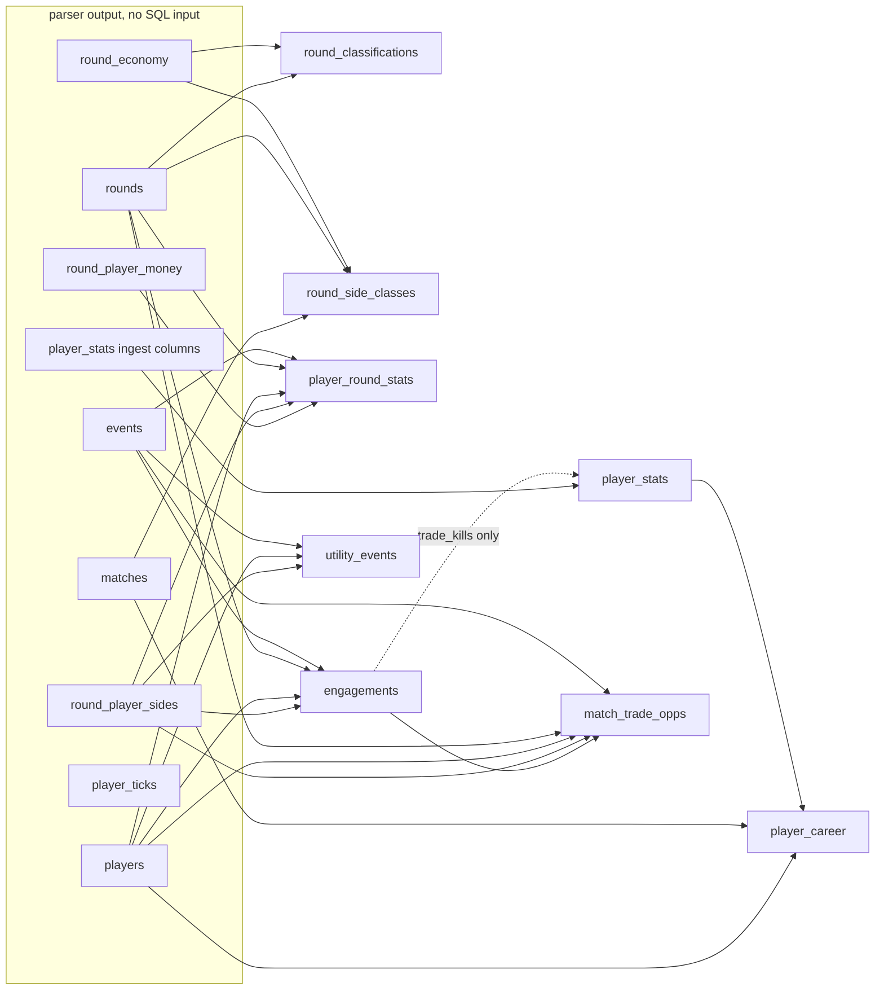

# S06 — Spike: audit analysis-table inputs

**Type:** spike (research)
**Source:** `source/PRUNE.md` (research item 8, blast radius)

## Goal
Replace the upper-bound blast radius (105 of 147 metrics) with an exact
dependency map. For each analysis table, list its real inputs.

## Tables
`player_stats`, `player_round_stats`, `round_classifications`,
`round_side_classes`, `kill_tags`, `match_trade_opps`.

## Work
- For each table, trace the Go writer (`analytics.Compute`, `store/analytics.go`)
  and list which tables and columns it reads.
- Build a dependency graph from table to table, and table to metric.
- Confirm against the stored `metrics.touched` sets.

## Acceptance
- A dependency graph with one node per table and an explicit input list.
- A corrected blast-radius count for S16 and S17.

## Unblocks
Accurate scoping of S16 and S17.

## Not covered
Writers that read `player_ticks` through unexpected paths may be missed by
reading code alone. S03 can confirm this empirically.

## Result

Method: (1) read the Go writer path (`analytics/compute.go`, the `Get*` and
`Replace*` functions in `store/analytics.go` and `store/queries.go`, and
`fold_derived.go` and `clutch_sql.go`); (2) grepped every non-test Go file for
`player_ticks` and for every INSERT/UPDATE/DELETE on the analysis and round
tables; (3) ran the 147 seeded builtin metric exprs (`store/schema.sql`, with
the clutch CTE spliced in at `{{CLUTCH_CTE}}`) through SQLite's authorizer to
get the physical tables and columns each one reads, then closed that over the
writer graph and over `metric()` references.

`kill_tags` is not a table. The UI calls `engagements` "Kill tags"
(`frontend/src/lib/strings/combat.js`), so it is treated as `engagements`
below. The S06 table list was used as written.

### Writer inputs (verified by reading)

`analytics.Compute` reads these from the store, and no analysis writer reads
`player_ticks`:

| Read by Compute | Columns actually used |
|---|---|
| `matches` | tick_rate, side_switches, rule stamp |
| `rounds` | number, winner, start_tick, end_tick, freeze_end_tick, equip_ct, equip_t |
| `round_economy` | round, side, equip_value, money_sampled_sum, money_samples |
| `round_player_sides` | round, steam_id, side |
| `round_player_money` | round, steam_id, money_start, equip, spent |
| `players` | steam_id, name, side, is_bot |
| `events` (typed columns) | seq, tick, round, kind, attacker, victim, assister, weapon, headshot, wallbang, noscope, through_smoke, attacker_blind, assisted_flash, distance, hitgroup, dmg, site |
| `events.detail_json` | kill rows: `$.nearDist`; `kind='blind'` rows: flash duration |

Per analysis table:

1. **round_classifications**: `round_economy`, `rounds` (`Classify`, pure).
2. **round_side_classes**: `round_economy`, `rounds`, and `matches.side_switches`
   for the team stamp (`rules.TeamKeyAt`).
3. **player_round_stats**: `events`, `rounds`, `players`, `round_player_sides`,
   `round_player_money`.
4. **engagements** (= kill tags): `events`, `rounds`, `players`, `round_player_sides`.
5. **player_stats**: at ingest, every column comes from the parser
   (`lifecycle.go`). `trade_kills` alone is rewritten by Compute from
   `engagements` (KindTrade per killer, `ReplaceTradeKills`). So only
   `trade_kills` depends on the engagements chain.
6. **match_trade_opps**: kill `events` (tick, round, attacker, victim) and
   `events.detail_json.nearDist`, `rounds`, `round_player_sides`, `players`,
   and in-memory `engagements`.
7. **utility_events** (not in S06's list, but a writer of the same shape):
   `events` (kind, tick, round, seq, attacker, victim, weapon, site, dmg),
   `players`, `round_player_sides`, `events.detail_json` (blind).
8. **player_career** (rollup, not per match): `player_stats`, `matches`,
   `players` (humans only). No column of `player_ticks` is read.

`analytics/*.go` makes no store calls (grep confirmed). It works on in-memory
inputs only.

Round-side inputs are not tick rows. `round_player_sides`, `round_player_money`
and `round_economy` are appended during the parse (`extract/agg.go` around line
600), from the same per-frame sampler that feeds the tick sink. They are
parallel outputs, not SQL reads of `player_ticks`.

`fold_derived.go` (`playerRoundFoldsAll`) reads `player_round_stats`, `events`
(kill, damage, `post_match`, `capped_dmg`) and `round_player_sides`. It does not
read `player_ticks`. Its callers (`GetPlayerSideSplits`, `roundFolds`) are
profile read paths.

`clutch_sql.go` (`clutchCTE`, also used by `ClutchRows` for the Combat panel and
match report) reads `player_ticks` (`steam_id`, `side`, `round`, `tick`,
`alive`, `hp`), `events` (kill, damage, bomb kinds, `detail_json`), `players`
and `rounds`.

### Dependency graph

Metric edges come from the 147 builtins (direct physical reads, then `metric()`
closure). Direct counts, from the authorizer:

| Table | Direct metric readers |
|---|---|
| players | 101 |
| events | 58 |
| round_player_sides | 50 |
| player_stats | 44 |
| player_round_stats | 26 |
| rounds | 20 |
| player_ticks | 11 |
| round_side_classes | 8 |
| round_classifications | 6 |
| utility_events | 6 |
| engagements | 5 |
| round_economy | 4 |
| match_trade_opps | 3 |
| round_player_money | 1 |
| matches | 1 |

### Blast radius, re-derived

A metric depends on a table if it reads that table directly, or reads a table
derived from it through the writer graph above, or reaches it through a
`metric()` reference. The `metric()` closure matters: the gate's `touched` set
records physical tables only, so 35 of the 147 builtins have no physical read
at all (for example `career_*`, `map_*`, `win_pct`).

- **S17 (player_ticks): 14 metrics.** Direct: `alive_count`, `clutch`,
  `clutch_avg_equip`, `clutch_avg_hp`, `clutch_avg_size`, `clutch_win_rate`,
  `clutches`, `dmg_no_kill`, `kill_conversion`, `match_clutch_wins`,
  `match_weapon_damage` (11). Through `metric()`: `career_clutch_win_rate`,
  `career_clutches`, `weapon_damage` (3). No analysis table adds to this set.
  Outside the metric count: `ClutchRows` (the Combat panel and match report),
  and any user or plugin metric or console query (not in the 147).
- **S16 (round_player_sides, round_player_money, round_economy): 113 metrics.**
  Per table: `round_player_sides` 105, `round_player_money` 35,
  `round_economy` 18. Direct-only union: 55. With the `trade_kills` column
  refinement, which stops the player_stats edge for metrics that do not read
  that column. Without the refinement it is 126.
- **Reconciliation with the previous figures.** The direct union of the round
  tables and `player_ticks` is 66, which matches PRUNE.md. The 105 figure was
  a union with the analysis tables. Direct, that union is 107, and with the
  closure it is 140. The 105 was therefore not an upper bound on player_ticks.
  Only 14 metrics depend on player_ticks.
- Small mismatches with PRUNE.md's table counts: `players` 101 (PRUNE says 103)
  and `player_stats` 44 (PRUNE says 46). Not resolved. Likely a counting
  difference. The stored `metrics.touched` sets were not available to check.

### Caveats

- **Stored touched sets not verified.** The repo has no live `metrics.touched`
  values (builtins seed as `''`, and the gate derives them at save). I rebuilt
  the set with SQLite's authorizer, which is what the gate's table rule reads.
  This is not compared against a live database.
- **Builtins only.** The 147 are the seeded builtins. User and plugin metrics,
  and the SQL console (`metricReadable` allows `player_ticks`, `events` and
  others), are outside the count, so 14 is a floor for product-wide reads.
- **Reading limits.** The `player_ticks` grep covered literal names in non-test
  Go. Dynamic table names were not checked. The frontend `livestats.js` mention
  was not traced. Column lists for `events` come from field-access grep, so they
  are close to complete, not compiler-proven.
- **Writers by unexpected path.** Grep for INSERT, UPDATE and DELETE on the
  analysis and round tables found only `ticks.go` (player_ticks), `analytics.go`
  (`trade_kills`) and `lifecycle.go` (ingest). None was missed, but this is
  still reading, not execution. S03 should confirm it empirically.
- **Scope of `player_stats`.** The table-level edge from engagements is
  over-broad. The refinement above is what keeps S16 at 113 and not 126.
